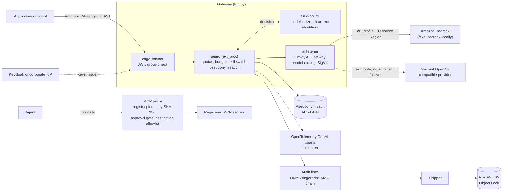

# Architecture

The kit sits between the applications of a regulated organisation and Claude on Amazon Bedrock. Nothing in the diagram needs an AWS account to run locally: Bedrock is replaced by a fake that enforces the same IAM rules.

## Reading the diagram

- Two Envoy listeners are needed because Envoy AI Gateway inserts its own filters after the guard has seen the request. Details in [gateway/README.md](../gateway/README.md).
- The guard pseudonymises before the request leaves the gateway and restores the originals in the answer, buffered or streamed. Bedrock only sees typed placeholders such as `<NIR_1>`. See [pseudonymisation/README.md](../pseudonymisation/README.md).
- The Terraform modules in `infra/terraform/modules/` carry the same rules into an AWS account: IAM role limited to the `eu.` profile, optional Service Control Policy, audit bucket under Object Lock, endpoint restricting egress.
- The MCP proxy is separate from the model path: it governs what an agent may call, not what the model may read. See [agents/README.md](../agents/README.md).
- The compliance file ties every control to a legal text and to an automated test: [docs/compliance/matrix.md](compliance/matrix.md).
